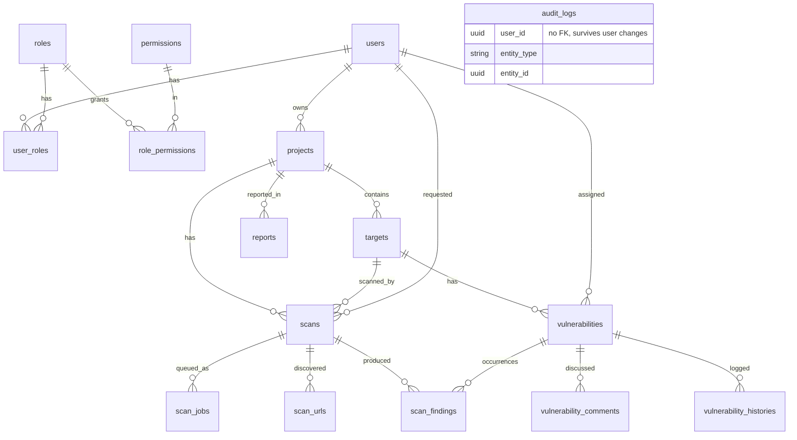

# Data model

PostgreSQL, EF Core migrations in `backend/src/WebSec.Infrastructure/Data/Migrations`. Tables/columns are `snake_case`; enums are stored as `varchar(30)` strings; timestamps are `timestamptz` (UTC `DateTimeOffset`). Primary keys are `uuid`.

## Implemented (migrations `InitialCreate`, `AddVulnerabilities`, `AddReports`, `AddAuditLogs`)



| Table | Notes |
|---|---|
| `users` | `user_name`, `email` unique; `password_hash` (ASP.NET Core `PasswordHasher`); audit + soft-delete fields |
| `roles` | `code` unique (`Admin`, `SecurityAnalyst`, `Developer`, `Viewer`), non-deletable |
| `permissions` | `code` unique, e.g. `Project.View`, `Scan.Create`, `AI.Ask` |
| `user_roles`, `role_permissions` | composite PK join tables |
| `projects` | `code` unique among non-deleted rows (`is_deleted = false` filtered index); `owner_id` → users |
| `targets` | `base_url`, `environment`, `scope_mode`, `is_enabled`, **`is_authorized`** (explicit user confirmation), `last_scan_at` |
| `scans` | lifecycle `status`, `progress_percent`, counters, safe error fields. History table: no soft delete |
| `scan_jobs` | persistent queue: `status`, `attempt_count`, `available_at`, `locked_at`, `locked_by`, `last_error_safe` |
| `scan_urls` | discovered URLs with `is_in_scope` |
| `scan_findings` | `severity`, `confidence`, redacted `evidence_summary`, `evidence_redacted`, `fingerprint` (SHA-256 of target+type+url+param), `vulnerability_id` (nullable FK, `SET NULL`) |
| `vulnerabilities` | one real issue per (`target_id`, `fingerprint`) – unique index. `status` (`VulnerabilityStatus`), `severity`, `assignee_id`, `is_reappeared`, `close_reason`, `review_at`, `first/last_detected_at`, `resolved_at`. Created/updated by `VulnerabilitySync` when the worker stores findings; never deleted |
| `vulnerability_comments` | `content`, `user_id`, `is_ai_note` (saved from the AI panel, shown with an AI-generated label) |
| `audit_logs` | append-only: `user_id` (no FK, survives user changes), `action` code (e.g. `USER_ROLE_CHANGED`, `SCAN_STARTED`, `LOGIN_FAILED`), `entity_type`, `entity_id`, `result` (Success/Blocked/Failed), `summary`, `detail_json` (keys matching password/token/secret/cookie/session masked as `••••`), `ip_address` (last part hidden), `created_at`. Written by `IAuditLogger` in the same `SaveChanges` as the change it records |
| `reports` | `project_id`, `title`, `template` (Executive/Technical), `status` (Generating/Ready/Failed), `snapshot_json` (frozen `ReportSnapshotModel`, system data only), `error_safe`, `created_by`, `created_at`, `completed_at`. Generated synchronously by `ReportService`; immutable once Ready |
| `vulnerability_histories` | `old_status`, `new_status`, `summary`, `changed_by` (null = system) |

### Vulnerability lifecycle & risk score
- Transitions follow the canvas state machine (S2), enforced in `Vulnerabilities/VulnerabilityStateMachine.cs`: triagers (`Vulnerability.Triage`: Admin, SecurityAnalyst) triage, verify, reopen and close as False Positive / Accepted Risk (reason required, Accepted Risk also needs `review_at`); the assignee moves Assigned/Reopened → InProgress → PendingVerification (note required). Nobody returns to Open; AI never transitions.
- A finding whose vulnerability is `Resolved` sets `is_reappeared = true` and logs history; the status is not changed automatically.
- Findings stored before this migration are linked on API startup by `VulnerabilitySync.BackfillAsync` (idempotent).
- Dashboard risk score = `min(100, 25×Critical + 10×High + 4×Medium + 1×Low)` over open vulnerabilities (`DashboardService.RiskWeights`).

Base types (`WebSec.Shared/Entities/BaseEntities.cs`): `BaseEntity<TId>` → `DeleteEntity` (`is_deleted`, `deletable`, `is_active`) → `AuditEntity` (`created_date`, `created_by`, `updated_date`, `updated_by`, set centrally in `AppDbContext.SaveChanges`) → `TempEntity` (`code`, `name_l`, `name_e`, for future master data).

### Indexes
FKs; `scans(status)`, `scans(created_at)`; `scan_jobs(status, available_at)`; `scan_findings(fingerprint)`, `scan_findings(severity)`; `targets(base_url)`; unique codes above.

### Delete behavior
- Normal CRUD never hard-deletes: projects/targets set `is_deleted = true`; global query filters hide them.
- `projects → targets → scans` FKs are `RESTRICT`, so scan history cannot be cascaded away.
- `scans → scan_jobs/scan_urls/scan_findings` are `CASCADE` (only relevant to an explicit administrative purge).

## Planned (not yet in the schema)
`project_members`, `refresh_tokens`, `ai_conversations`, `ai_messages` – fields as in the specification §7. CVSS / priority / SLA columns on `vulnerabilities` are not modelled yet.

## Migrations

```bash
cd backend
dotnet tool restore                      # installs dotnet-ef 8.0.11 from .config/dotnet-tools.json
dotnet ef migrations add <Name> -p src/WebSec.Infrastructure -s src/WebSec.Infrastructure -o Data/Migrations
dotnet ef database update -p src/WebSec.Infrastructure -s src/WebSec.Infrastructure   # uses DATABASE_URL or the local default
```

The API applies pending migrations automatically at startup in Development (or when `APPLY_MIGRATIONS=true`).
