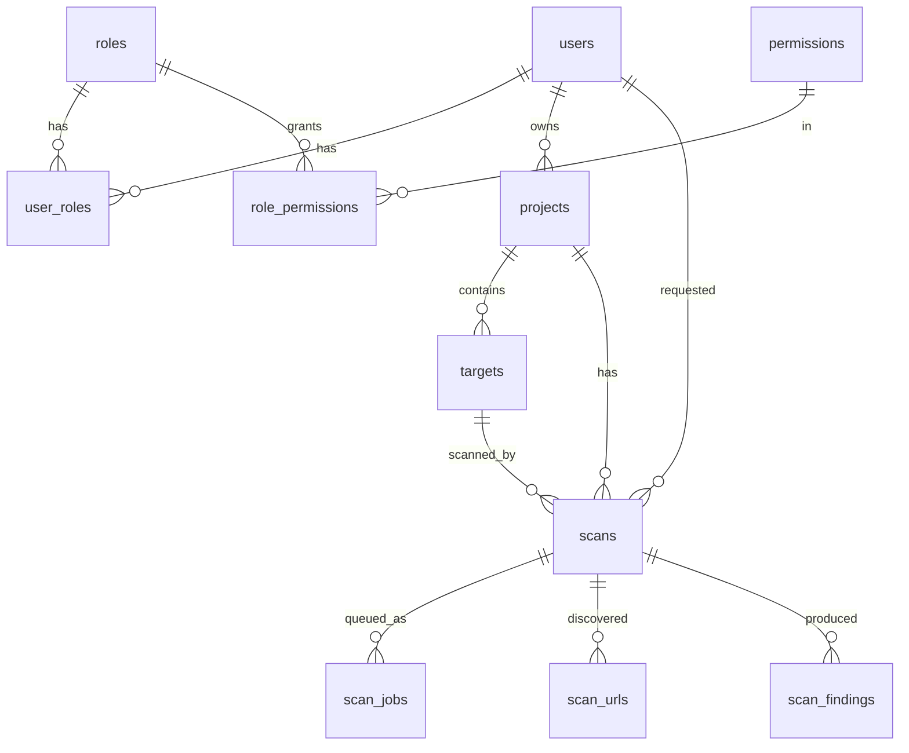

# Data model

PostgreSQL, EF Core migrations in `backend/src/WebSec.Infrastructure/Data/Migrations`. Tables/columns are `snake_case`; enums are stored as `varchar(30)` strings; timestamps are `timestamptz` (UTC `DateTimeOffset`). Primary keys are `uuid`.

## Implemented (migration `InitialCreate`)



| Table | Notes |
|---|---|
| `users` | `user_name`, `email` unique; `password_hash` (ASP.NET Core `PasswordHasher`); audit + soft-delete fields |
| `roles` | `code` unique (`Admin`, `SecurityAnalyst`, `Developer`, `Viewer`), non-deletable |
| `permissions` | `code` unique, e.g. `Project.View`, `Scan.Create`, `AI.Ask` |
| `user_roles`, `role_permissions` | composite PK join tables |
| `projects` | `code` unique among non-deleted rows (`is_deleted = false` filtered index); `owner_id` → users |
| `targets` | `base_url`, `environment`, `scope_mode`, `is_enabled`, **`is_authorized`** (explicit user confirmation), `last_scan_at` |
| `scans` | lifecycle `status`, `progress_percent`, counters, safe error fields. History table: no soft delete |
| `scan_jobs` | persistent queue: `status`, `attempt_count`, `available_at`, `locked_at`, `locked_by`, `last_error_safe` |
| `scan_urls` | discovered URLs with `is_in_scope` |
| `scan_findings` | `severity`, `confidence`, redacted `evidence_summary`, `evidence_redacted`, `fingerprint` (SHA-256 of target+type+url+param) |

Base types (`WebSec.Shared/Entities/BaseEntities.cs`): `BaseEntity<TId>` → `DeleteEntity` (`is_deleted`, `deletable`, `is_active`) → `AuditEntity` (`created_date`, `created_by`, `updated_date`, `updated_by`, set centrally in `AppDbContext.SaveChanges`) → `TempEntity` (`code`, `name_l`, `name_e`, for future master data).

### Indexes
FKs; `scans(status)`, `scans(created_at)`; `scan_jobs(status, available_at)`; `scan_findings(fingerprint)`, `scan_findings(severity)`; `targets(base_url)`; unique codes above.

### Delete behavior
- Normal CRUD never hard-deletes: projects/targets set `is_deleted = true`; global query filters hide them.
- `projects → targets → scans` FKs are `RESTRICT`, so scan history cannot be cascaded away.
- `scans → scan_jobs/scan_urls/scan_findings` are `CASCADE` (only relevant to an explicit administrative purge).

## Planned (not yet in the schema)
`project_members`, `refresh_tokens`, `vulnerabilities` (+ `vulnerability_scan_findings`, `vulnerability_comments`, `vulnerability_history`), `audit_logs`, `reports`, `ai_conversations`, `ai_messages` – fields as in the specification §7. Vulnerabilities will be created by deduplicating `scan_findings` on `fingerprint`.

## Migrations

```bash
cd backend
dotnet tool restore                      # installs dotnet-ef 8.0.11 from .config/dotnet-tools.json
dotnet ef migrations add <Name> -p src/WebSec.Infrastructure -s src/WebSec.Infrastructure -o Data/Migrations
dotnet ef database update -p src/WebSec.Infrastructure -s src/WebSec.Infrastructure   # uses DATABASE_URL or the local default
```

The API applies pending migrations automatically at startup in Development (or when `APPLY_MIGRATIONS=true`).
